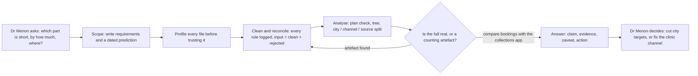

# c2-build1-brief-a-group-09

# Build 1 · Brief A · Which part of my business is short? · Group 09

Dr Menon, the COO of Kalpa Health, asked us to show which part of her business is short against the plan, by how much and where. The plan was 18% more tests in the first half of 2026 and the half closed at 5%, but the dashboard shows one monthly total, so nobody could say whether fewer people came, the same people came less often, or each visit carried fewer tests. The answer decides whether she cuts city targets and headcount on a "soft market" story or aims recovery effort at the part that is actually short, while fixed costs are still sized for 18%. We rebuilt test volume for both halves from the booking data, reproduced the 5%, split it into people × visits per person × tests per visit, and then split the gap by city, channel and booking source. The shortfall sits in the clinic channel, while home collection grew faster than plan.

## The claim

Test volume grew 5.0% in H1 2026 against H1 2025 (457,230 vs 435,430 tests, six cities) versus a plan of 18.4%, which leaves 58,510 tests, or 13.4 points, short. Clinic tests fell 11.9% (down in all six cities, from −6% to −25%), about 20 points below plan, while home collection grew 37.5%, about 6.5 points above plan.

The channel gap assumes each city's plan is spread over its channels in last year's mix, because the plan has no channel split. Growth percentages need no assumption.

## 1 · The problem, for whom, and the scope

| | |
|---|---|
| **Problem** | Test volume grew 5% against a plan of 18%. One monthly total hides where the 13 points went. |
| **For whom** | Dr Priya Menon (COO), who answers to a group board; the finance controller, who audits every number back to rows; the city heads, who are blamed. |
| **Decision it drives** | Cut targets and headcount city by city, or fix one part of the business. |
| **In scope** | The data pack as released, first half of 2026 against the same half of 2025, six cities. Brief A answered end to end. Python notebooks, SQL for the cross-check, Excel for the one board number. |
| **Out of scope** | Forecasting next quarter, fixing Kalpa's systems, data we do not have (named in the caveat), dashboards. |
| **Targets** | T1 reproduce the 5%. T2 one sentence with number, denominator and period. T3 every number traces to rows. T4 notebooks run top to bottom in under ten minutes. T5 every member can defend every number. |

## 2 · What we compared before choosing an approach

| Approach | Where it comes from | Pros | Cons | What we did |
|---|---|---|---|---|
| **One monthly total** | Kalpa's current dashboard | Simple | Cannot say where the shortfall is | Rejected: it is the problem |
| **Peers' three-number tree**: revenue = patients × tests per patient × revenue per test | Dr Lal PathLabs and Metropolis Healthcare quarterly results, as quoted in the handbook (Dr Lal: revenue +19.1%, patients +8.2%, samples +10.7%; Metropolis: revenue +16.6%, patients +10%, tests +11%) | What a diagnostics board already reads | No city or channel; Dr Lal counts samples and Metropolis counts tests, so unit prices are not comparable | Used as the revenue tree |
| **Our tree**: tests = patients × visits per patient × tests per visit, split by city, channel and source, against the plan | Handbook Brief A, extended | Separates "fewer people came" from "the same people came less often" | The plan has no channel split, so the channel gap needs an assumption | **Chosen** |

We also compared three tables to count tests from: **bookings** (chosen, because the plan divided by our 2025 count is steady inside each city, 1.16 to 1.20), **collections** (samples, one row per booking) and **results** (tests the lab ran, which excludes no-shows and covers 81.6% of booking rows; it gives +4.98% against +5.01%). Reading list: `guides/07-research-links.md`.

## 3 · The business flow: from her question to her decision



**Value:** she stops treating a clinic problem as a soft market. **Trade-off:** the plan has no channel split, so the channel gap rests on one stated assumption. **Risk:** the free home collection offer (₹150 waived, January to March) overlaps the period, so part of the clinic fall may be patients switching channel. **Next steps:** test who used the offer, then run a holdout before any budget change. The diagrams in `docs/diagrams/` (system context, data context, high-level and low-level design, booking life cycle, decision flow) show the same story in more detail.

## 4 · How it is built

```mermaid
flowchart LR
    subgraph SRC["Source systems, exported and not cleaned"]
        B1["Bookings legacy: csv, latin-1, day-first dates"]
        B2["Bookings nova: json lines, tests nested"]
        CO["Collections app"]
        PA["Patient master"]
        PL["City plan"]
        CA["Campaign files"]
    end
    SRC --> RAW["data/raw: as received, never edited"]
    RAW --> N1["01 profile"]
    N1 --> N2["02 load every file, check every column"]
    N2 --> N3["03 clean, reconcile, patients to people"]
    N3 --> CL["data/clean: bookings_clean.csv.gz and decision logs"]
    CL --> N4["04 SQL cross-check in SQLite"]
    CL --> N5["05 methods: plan check, tree, splits, stress test"]
    N5 --> N6["06 answer and cold run"]
    N6 --> OUT["slides: charts and board_number.xlsx"]
```



| Choice | Why this and not that |
|---|---|
| **pandas for loading and cleaning** | The files need Latin-1 decoding, day-first dates and nested JSON, which SQL reads badly. |
| **SQLite for the cross-check** | It ships with Python and finance can re-run the queries. If SQL and pandas disagree, one has a bug. |
| **A simple loop over files, not a process pool** | About 110 booking files load in a few minutes; the loop is easier to read and explain. |
| **Excel for the board number** | The finance controller can click the formula cell and audit it without Python. |

**Known limitation:** the plan has no channel or source split; the offer analysis has no control group; revenue is booked at list price, not billed; the patient merge rule (same phone and name) cannot prove two records are one person.

## 5 · The demo, step by step

From a fresh Codespace (about five minutes):

1. Clone the repository and run `pip install -r requirements.txt`.
2. Open `notebooks/06_answer_cold_run.ipynb` and choose Restart and Run All.
3. **Pass:** the last cell prints the headline, `457,230 of 435,430 tests = +5.0%`, with the plan (`515,740, +18.4%`).
4. **Pass:** the reconcile lines say PASS (input = clean + rejected; SQL equals pandas; the tree branches multiply back to the total).
5. **Pass:** `slides/` holds the charts and `board_number.xlsx`, whose formula cell equals the number in B3.

Charts are saved quietly and not drawn on screen (`SHOW_CHARTS = False` in notebook 06). If `data/clean/` is empty on a new clone, run notebooks 01 to 05 first.

## 6 · How to run it

1. Open this repository in a GitHub Codespace.
2. Run `pip install -r requirements.txt`.
3. Check that `data/raw/` holds the data pack folders (`bookings`, `collections`, `patients`, `plan`, `campaigns`, `results`, `reference`, `invoices`, `payments`) and `MANIFEST.json`.
4. Run the notebooks in `notebooks/` in numerical order, each from a fresh kernel (Kernel, Restart and Run All): `01_profile`, `02_load_parallel_validate`, `03_clean_reconcile`, `04_sql_transformations`, `05_methods`, `06_answer_cold_run`.
5. The headline number appears in the last cell of `06_answer_cold_run.ipynb`. Expected value: **+5.0% test volume growth, 457,230 tests in H1 2026 against 435,430 in H1 2025**.
6. Runtime on a fresh Codespace: [FILL after the cold run, in minutes].

## 7 · The repository, as the panel finds it

```
c2-build1-brief-a-group-09/
├── README.md                     this file
├── requirements.txt              the packages the notebooks import
├── data/
│   ├── raw/                      the data pack as received, never edited
│   │   ├── bookings/ (legacy/, nova/)   collections/   patients/   plan/
│   │   ├── campaigns/   results/   reference/   invoices/   payments/
│   │   ├── MANIFEST.json         every file with its size and SHA-256
│   │   └── README.md             provenance of the pack
│   └── clean/                    written by the notebooks (large files are not committed)
├── notebooks/
│   ├── 00_template.ipynb         the shape every notebook follows
│   ├── 01_profile.ipynb          profile one file of each kind, id audit
│   ├── 02_load_parallel_validate.ipynb   load legacy and nova, check every column
│   ├── 03_clean_reconcile.ipynb  logged cleaning rules, collections join, patients to people
│   ├── 04_sql_transformations.ipynb      the same numbers in SQL
│   ├── 05_methods.ipynb          plan check, tree, splits, stress test, offer
│   └── 06_answer_cold_run.ipynb  headline, charts, board number, cold run
├── docs/
│   ├── project-charter.md  project-statement.md
│   ├── approach-log.md  decisions-log.md  challenges-log.md  cold-run-log.md
│   ├── writeups.md  ai-log.md  questions-to-ponder.md  interview-bank.md
│   └── diagrams/  diagrams.md    nine diagrams, Mermaid source and PNG
├── guides/                       the kit's seven guides
├── slides/                       six slides (pptx and pdf), charts, board_number.xlsx
├── sql/                          06_brief_a.sql, the queries finance can re-run
├── src/                          shared helpers
└── tests/                        pytest cases for the shared helpers
```

## Members and parts

| Member | Part of the work owned | Pipeline notebooks | Working notebook (first pass) | Approach-log rows |
|---|---|---|---|---|
| Vasudev Kamath Mundkur | Merging the two booking systems, cleaning rules and decisions log, the final claim sentence | `02`, `03` (sections 1 and 3) | `load_clean_booking.ipynb` | 3, 5, 7, 11 |
| Nisha Kherala | Patient identity (one person, many ids), counting rule, stress test | `03` (sections 2 and 4), `05` (section 5) | `load_clean_patients.ipynb` | 1, 4, 6 |
| Aditya Kr Sharma | The tree, city and channel split, new vs returning patients, charts and the board number | `05`, `06` | `Analyse_data.ipynb` | 2, 8, 9, 10 |

## Links

| What | Where |
|---|---|
| Video | [Group 09 video folder](https://drive.google.com/drive/folders/18USWeLsqdSYJhHmWHgWXddrwnMJKKGpN) (viewable by anyone with the link) |
| Slides | `slides/Brief_A_Final_Deck(1).pptx` |
| Data pack provenance | `data/raw/README.md` |

## The logs

`docs/approach-log.md` · `docs/decisions-log.md` · `docs/challenges-log.md` · `docs/writeups.md` · `docs/ai-log.md` · `docs/cold-run-log.md`

## Working agreement

Nobody pushes to `main`. Every change arrives by pull request approved by a member who did not write it. Merges are merge commits so the history stays readable. Notebook outputs are cleared before commit. The build freezes the evening before presentations.
